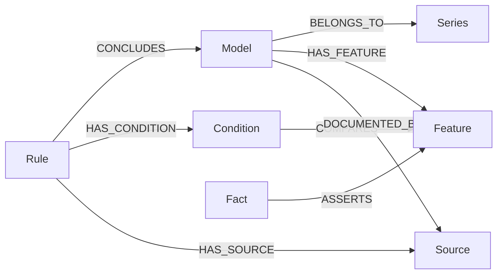

# Neo4j 铁路知识图谱

## 数据分工

SQLite 保存可编辑的知识库、规则、事实和实验快照。Neo4j 保存其图谱投影。
网页查询从 Neo4j 读取节点和关系，使用 Cytoscape.js 展示交互关系图，周边控件使用 Element Plus。
Neo4j 不可用时显示连接状态，不使用 SQLite 数据伪装成已连接的图数据库。
图谱可以从 SQLite 重建，不反向覆盖原有规则、事实及用户数据。

## 节点与关系

| 节点 | 内容 |
| --- | --- |
| Model | 车型，如 CRH5A |
| Series | 车型系列，如 CRH5 |
| Feature | 类型化的字段和值，如适用环境为高寒 |
| Rule | 规则名称、编号、启停、优先级、AND / OR |
| Condition | 单条规则中的字段、运算符和值 |
| Fact | 可复用事实条目及其编号 |
| Source | 资料链接 |
| Conclusion | 没有车型来源标识的普通推导结论 |

所有实体还有公共标签 `RailwayEntity` 和 `kb_id`，实体 `uid` 由知识库、类型和业务键生成。
同一知识库相同字段和值只生成一个 Feature；同一值在不同字段或知识库中保持独立。



`HAS_FEATURE` 来自已核对的来源参数，不把规则条件直接视为车型的已知属性。
例如“品牌等于和谐号”规则前提经过 Condition 连向 Feature，具有明确的比较语义。
资料标明的“高寒”直接由 Model 连向 Feature。图谱中的来源链接支持复查。
未核对、停用车型仍可展示其规则和目录信息，但不根据不可靠参数生成车型特征关系。

## 本机连接

由用户安装并启动 Neo4j，创建数据库并完成初次密码设置。
将根目录 `.env.example` 复制为 `.env.local`，填写连接参数：

```dotenv
NEO4J_URI=bolt://127.0.0.1:7687
NEO4J_USER=neo4j
NEO4J_PASSWORD=填写本机数据库密码
NEO4J_DATABASE=neo4j
NEO4J_BROWSER_URL=http://127.0.0.1:7474/browser/
```

密码仅由后端读取，`.env.local` 已忽略；不要填写 `VITE_` 前缀，也不要把密码写进前端。
设置后重新启动 `npm run dev:full`，仍由该命令同时启动前后端；Neo4j 由用户单独启动。
API 的 SQLite 健康状态与 Neo4j 状态分开，图数据库离线不影响问答推理和事实编辑。

```bash
npm run graph:check
npm run test:neo4j
npm run graph:sync -- --base-id 2
```

也可以在“知识图谱”点击“重新检测”和“同步图谱”。
同步只替换目标知识库的 `RailwayEntity` 投影，使用事务和知识库同步锁，失败会回滚。
固定的节点标签、关系类型由服务端白名单生成，属性和查询条件使用参数传入。
其他标签、其他知识库的数据不参与替换。当前实现不会自动清除已删除知识库的 Neo4j 投影，
该知识库在网页和 API 中已不可访问；需要时可通过 Neo4j 管理工具清理其投影。

## 网页操作

连接后同步知识库。搜索车型名称，可选择同时展示 1、3、6 或 12 个车型的相关网络。
点击节点显示属性与关联表格，支持拖动、缩放、画布适配以及节点列表查看。
图谱默认展示一个车型及其规则、条件、特征、系列、事实和来源，避免全部关系挤在同一画布。
展示数量与匹配总数分别呈现。修改规则、事实后，状态指纹变化，显示“待同步”。

## 接口

```text
GET  /api/knowledge-bases/:baseId/graph/status
POST /api/knowledge-bases/:baseId/graph/sync
GET  /api/knowledge-bases/:baseId/graph?q=CRH5A&limit=1
```

无配置时状态返回 `configured: false`，查询和同步返回 503。
连接失败、权限不足返回不含连接机密的错误；其他知识库或不存在的路径受知识库作用域约束。
查询只接收 `q` 和 `limit`，不能提交任意 Cypher；搜索最长 100 字，车型数量 1–12。
同步信息包括节点数、关系数、时间和源数据指纹。

## 在 Neo4j Browser 复查

```cypher
MATCH (m:RailwayEntity:Model {kb_id: 2, title: 'CRH5A'})-[r]->(n)
RETURN m, r, n;
```

```cypher
MATCH (rule:RailwayEntity:Rule {kb_id: 2})-[:CONCLUDES]->(m:Model {title: 'CRH5A'})
MATCH p = (rule)-[:HAS_CONDITION]->(:Condition)-[:COMPARES]->(:Feature)
RETURN p, m;
```

```cypher
MATCH (m:RailwayEntity:Model {kb_id: 2})-[:HAS_FEATURE]->
      (f:Feature {field: 'environment', value: '"高寒"'})
RETURN m, f;
```

2026-10-22 已连接用户本机 Neo4j，并将“中国铁路”知识库实际导入：
1960 个节点、4722 条关系。后端查询确认同步指纹与 SQLite 当前数据一致。
后续编辑后实际数量以新的同步结果为准。

## 验证边界与参考

已通过图谱建模、重复实体去重、参数校验、知识库隔离和断连处理测试。
普通接口测试使用注入的测试存储。`npm run test:neo4j` 使用真实数据库验证驱动连接、
Cypher 执行、重复同步、作用域隔离和失败回滚，测试用负数知识库编号隔离，结束后清理测试数据。
真实库测试已通过：连通、重复同步、知识库隔离、写入失败后的整批回滚，测试数据已清理。
网页已核对 CRH5A 搜索、节点列表、节点详情和交互关系图，以及其高寒特征和系列来源关系。
普通自动测试 23 项通过，真实 Neo4j 集成测试 1 项通过，前端生产构建通过。

- [Neo4j 官方 JavaScript 驱动事务文档](https://neo4j.com/docs/javascript-manual/current/transactions/)
- [Neo4j 官方 Windows 安装文档](https://neo4j.com/docs/operations-manual/current/installation/windows/)
- [Cytoscape.js 文档](https://js.cytoscape.org/)
